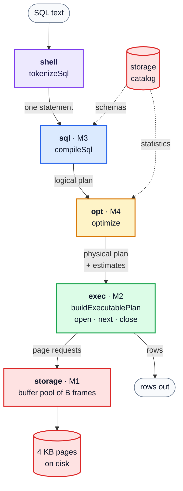
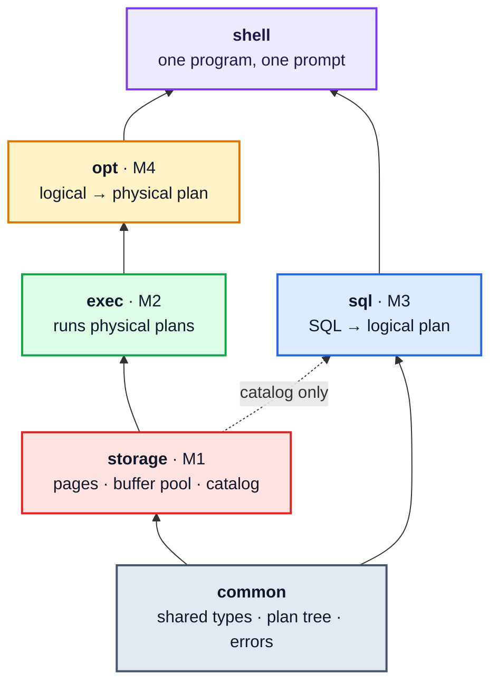
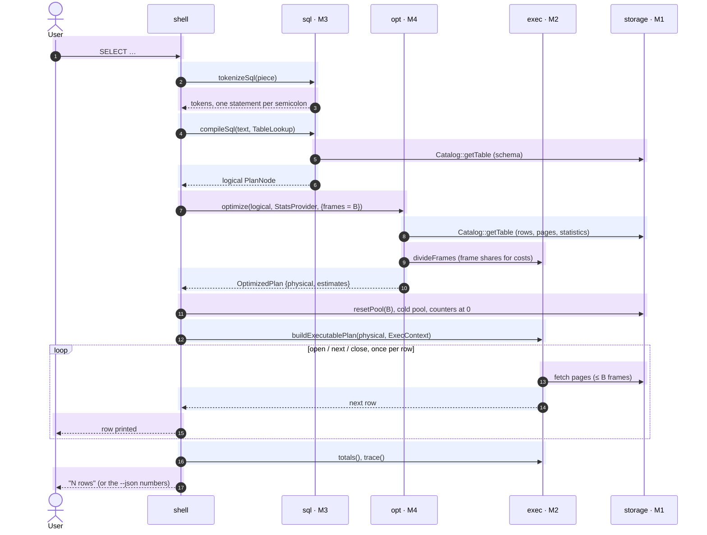
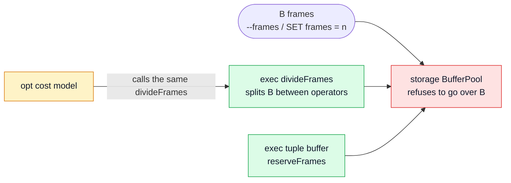
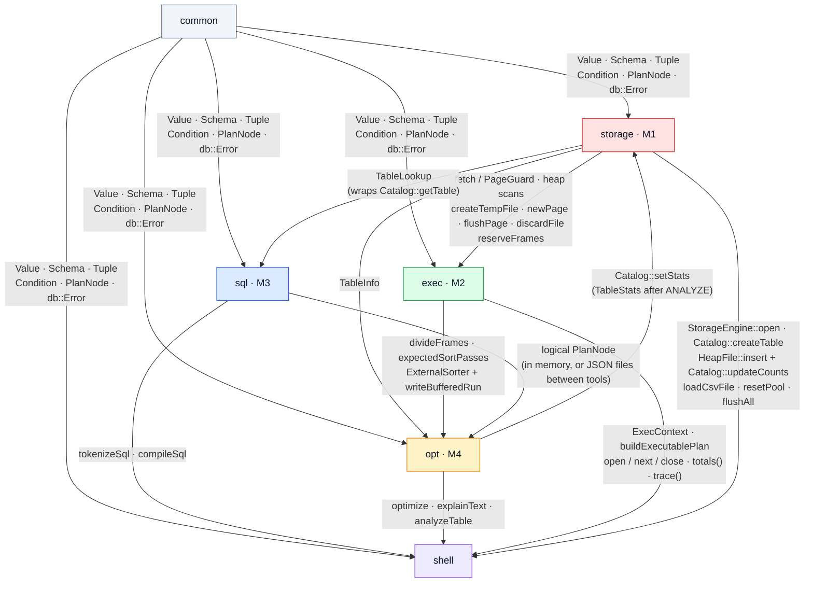

# ARCHITECTURE

One program, a single binary with a prompt: SQL goes in and rows come out. This file covers the three parts the integration spec asks for: **(1)** the whole system, **(2)** the interface between each pair of modules, **(3)** what we would do differently. It ends with the readings. Every function and type named here is in that module's `INTERFACE.md`.

---

## 1. The whole system

### 1.1 The pipeline: one SQL statement, top to bottom

What crosses each arrow, in the code's own names:

| Arrow | Type / calls |
|---|---|
| shell → sql | `compileSql(text, TableLookup)` |
| logical plan | `PlanNode` (or `CreateTablePlan` / `InsertPlan`) |
| sql → opt | `optimize(logical, StatsProvider, {frames = B})` |
| physical plan + estimates | `OptimizedPlan {physical, estimates}`: one `NodeEstimate` per node, pre-order |
| opt → exec | `buildExecutablePlan(physical, ExecContext)`; `divideFrames` splits B between operators |
| page requests | `fetch` / `newPage` / `reserveFrames` / `createTempFile` |
| catalog → sql, opt | `Catalog::getTable` (schemas; rows, pages, statistics) |

### 1.2 The modules and who uses whom

Read bottom to top: an arrow means **"is used by"**. Dependencies run one way only.

Each module at a glance (colours match the diagrams; bottom to top, like 1.2):

#### ⬜ common
- **Values:** `INT` · `VARCHAR(n)` · `REAL` (AVG only)
- **Schemas:** qualified column names
- **Conditions:** parser + evaluator
- **Plans:** one tree `PlanNode`, logical and physical, with its JSON reader and writer
- **Errors:** one type `db::Error`, 7 categories, printed by `formatError`
- **Never:** reads files · knows about pages

#### 🟥 storage · M1
- **Pages:** 4 KB slotted pages
- **Files:** heap files (chain of directory pages) · temp files
- **Memory:** the buffer pool, LRU / CLOCK
- **Catalog:** tables, counts, statistics
- **Counts:** every hit · miss · eviction · read · write
- **Never:**  it is the only module that touches files,

#### 🟩 exec · M2
- **Runs:** a physical plan as iterators (open / next / close)
- **Operators:** scans · filter · project · sort (external merge sort) · 3 joins · distinct · group_by · limit · set operators
- **Counts:** per-node counters
- **Never:** builds paths or opens files

#### 🟦 sql · M3
- **In → out:** SQL text → checked logical plan, in canonical order
- **Errors:** with line and column
- **Never:** runs anything

#### 🟨 opt · M4
- **Statistics:** ANALYZE
- **Estimates:** row counts
- **Plan:** rewrites → DP join order over left-deep plans → join algorithm
- **Hands over:** a plan exec runs unedited
- **Never:** changes exec's plan after handing it over

#### 🟪 shell
- **Runs:** one `StorageEngine` per run, one statement at a time
- **Adds:** `LOAD` · `ANALYZE` · `SET frames = n` · `EXPLAIN` · `EXPLAIN ANALYZE`
- **Never:** rewrites any module ("wiring, not rewriting"); the four tools `storage`, `exec`, `sql`, `opt` still work alone

### 1.3 One SELECT through the shell, call by call

Modules across the top, time going down. Each numbered step is one call (one arrow, one shaded band). **Compile:** steps 1–6 · **Plan:** 7–10 · **Run:** 11–17 (13–15 repeat once per row).

### 1.4 The one shared limit: B frames

At most B pages are in memory at any moment, **including tuples an operator keeps in C++ containers**. The limit is enforced in one place, the storage pool:

Opt calls exec's own `divideFrames`, so its cost estimates use exactly the frames exec will use.

---

## 2. The interface between each pair of modules

Only these pairs talk directly; by the dependency rule no other pair has an interface. Each arrow is labelled with what crosses it.

The rule each pair relies on:

| Pair | Rule |
|---|---|
| **common ↔ every module** | Plan JSON field names exist only in common's `plan_json` code. `aggregateOutputName` is the one naming rule for aggregate columns (`count_star`, `avg_R_salary`). Common uses nobody. |
| **storage → exec** | After `close()` a plan holds no pinned page and no live temp file: `ExecutablePlan::close`, `resetPool` and `StorageEngine::close` all refuse if one is left. Exec never builds a path or opens a file. |
| **storage → sql** | A lookup never reads a data page; names are case-sensitive. sql's library does not link storage. |
| **storage ↔ opt** | Rows and pages always come from the catalog counts (`TableInfo`), never from stale statistics; statistics reach the disk at `flushAll` / `close`. |
| **exec → opt** | Opt's physical plan runs in exec **unedited**; opt's estimate *i* = exec's trace row *i* (both pre-order); ANALYZE uses exec's external sort, as the spec requires. |
| **sql → opt** | Every column fully qualified except aggregate output names; only the 14 logical ops; at most 1000 levels deep. |
| **shell ↔ each** | The pool is emptied before each query (`resetPool`), so a query's counters never depend on what ran before it. |

---

## 3. What we would do differently

Drawn from recorded evidence: reversed rows in `DECISIONS.md`, the "where AI help was wrong" tables in each module's `STATUS.md`, opt's measurements and the shell rehearsal.

| # | Do differently | Evidence |
|---|---|---|
| 1 | **Design the memory split and the cost model together.** Agree on the frame rule first, and let the DP cost joins with the frames exec really gives them. | Exec divides B (`divideFrames`), but the spec's DP table (§M4.5) costs every join as if it had all of B. We kept both: the DP matches the spec, measured I/O is higher. In one case the DP picked a plan with **4,324** page I/Os where another needed **1,823** (opt `STATUS.md`, 2026-11-13). |
| 2 | **Read the spec's worked examples before any chunk guide.** | Reversals came from guide extras the spec never asked for: a table-name case check that broke the SQL spec ("`Emp` and `emp` are different tables"; added 10-27, removed 10-30); an "ndv cap" in opt that made estimates worse; questions already answered by sql examples 5.4/5.6 and exec §M2.3. The lean-code rule ("the spec decides") came only after M1. |
| 3 | **Plan for 1000-level trees in every recursive pass from day one.** Build nodes in place, keep frames small, and write a deep test with each recursive function. | The same stack overflow happened **four times**: common's RA parser, sql's parser, opt's rewriter, opt's physical conversion. Each was found late, by a deep-nesting test. |
| 4 | **Fix the page-access pattern of a scan early.** | The heap scan re-read its directory page before every data page, so a 200-page scan cost **333** reads at B = 4. It was changed to read each directory page once only in exec chunk 07 (DECISIONS 2026-11-07); the tuple-buffer page count was revised the same day. Both changed numbers that earlier tests had fixed. |
| 5 | **Wire the shell end to end earlier.** | The tools met through JSON files until the last week. Some user-visible differences from PostgreSQL only show in the integrated program: aggregate headers show generated names (`count_star`) instead of the `AS` alias, and a SUM above the INT range is an error. A thin shell in week 2 would have surfaced them while the modules were still open. |
| 6 | **Never edit through shell escapes, and prove every test can fail.** Edit with the editor tools only, and do a mutation run as part of writing each test. | Escapes in shell heredocs and `sed` commands broke edits or silently skipped a mutation at least **eight times**, across common, sql, opt and the shell. Mutation runs repeatedly found tests that could not fail (a sort pass count, a `limit 0` open, a cold-pool check). |

---

## 4. Readings

- **Hellerstein, Stonebraker and Hamilton, *Architecture of a Database System* (2007).** Its query processor (parse → rewrite → optimize → execute, with access methods and the buffer manager below) is the layering we kept: one module per stage, each stage hands the next a plan, never a shortcut into its data. Its argument that the DBMS, not the operating system, should manage memory and I/O is why the shell owns one buffer pool for the whole session and every operator's memory counts against it.
- **Andy Pavlo, CMU 15-445/645 *Intro to Database Systems* (Fall 2024).** Covered every module (cited in `DESIGN_M1.md` to `DESIGN_M4.md`). For the integration, the query-execution and optimization lectures led to two shell features: `EXPLAIN ANALYZE` putting each plan node's estimate and real row count side by side, and a cold buffer pool before each query, so measured I/O compares fairly with the cost model.
