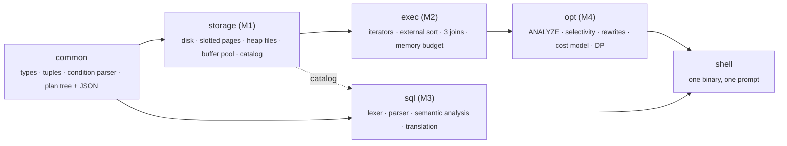

# A relational database engine, from the disk page up, in C++20

SQL goes in and rows come out. Everything in between is built here from scratch: a hand-written SQL parser, a semantic analyser, a cost-based optimizer, an iterator-model execution engine, and a page-based storage layer with its own buffer pool. No database libraries, no parser generators and no regular expressions are used. The only third-party code is a JSON library and a test framework.

The whole engine runs under a **hard memory budget of B pages** (`--frames B`, as small as 4). Every operator, including external sort, three join algorithms and hash aggregation, must finish correctly within it and report **deterministic I/O counters** that match its cost formula.

```
SELECT d.title, COUNT(*) AS n
  FROM Emp e JOIN Dept d ON e.did = d.did
 WHERE e.age > 30
 GROUP BY d.title
 ORDER BY n DESC;

        │  lexer → recursive-descent parser → name resolution & type checks
        ▼
  logical plan (JSON)    project ← sort ← group_by ← select ← join(rename(scan), rename(scan))
        │  statistics → selectivity → 7 rewrite rules → I/O cost model → DP join ordering
        ▼
  physical plan (JSON)   sort ← group_by[hash] ← hash_join ← (filter ← seqscan Emp, seqscan Dept)
        │  open / next / close iterators, ≤ B frames, per-operator counters
        ▼
  buffer pool (LRU | CLOCK) → heap files of slotted 4 KB pages → disk
```

---

## Architecture

The system is five libraries with a strict one-way dependency graph. Each module is usable as a library and as its own command-line tool, and the final shell wires them together without rewriting any of them.



| Module | What it does | The hard parts |
|---|---|---|
| **common** | Value and type system, qualified schemas, condition tokenizer, parser and evaluator, plan tree with a JSON reader and writer | Bag (not set) semantics; one shared nesting budget, so a 1,000-level query can't overflow the stack in *any* recursive pass; JSON errors that name the offending node |
| **storage** (M1) | 4 KB pages on disk, slotted pages, heap files with a directory-page chain, buffer pool with LRU and CLOCK, catalog, CSV loader | Byte-exact little-endian layouts; exact hit/miss/eviction counting; a scan that never pins more than two pages; RAII page guards that make leaked pins impossible |
| **exec** (M2) | Volcano-style iterators: seqscan, filter, project, distinct, group_by, sort, limit, set operations, nested-loop, sort-merge and Grace hash join | External merge sort on inputs 20× larger than memory; duplicate-key runs in sort-merge join; hash-partition overflow and skew; per-operator I/O attribution; dividing B across a whole plan |
| **sql** (M3) | Hand-written lexer and recursive-descent parser, scope-based name resolution, type and aggregate checks, canonical translation to a logical plan | Operator precedence enforced by grammar shape; `UNION` vs `UNION ALL` and where duplicate elimination really belongs; subqueries in `FROM`; precise `line:column` errors in seven categories |
| **opt** (M4) | Exact statistics with equi-depth histograms, selectivity estimation, seven rewrite rules, an I/O cost model, Selinger-style dynamic programming over left-deep join trees | Every rewrite guarded by its precondition, because a wrong rewrite gives wrong answers, not slow ones; costs that match the executor's measured I/O; choosing the join algorithm per B |
| **shell** | One interactive binary: `CREATE`, `INSERT`, `SELECT`, `LOAD`, `ANALYZE`, `SET frames = n`, `EXPLAIN`, `EXPLAIN ANALYZE` | Wiring, not rewriting; estimated vs actual rows at every node; results verified against PostgreSQL |

Each module's public API is summarised in its `modules/<module>/INTERFACE.md`; modules use each other only through those headers.

---

## Engineering constraints

These rules hold everywhere in the code base, and the tests check them:

- **Bounded memory.** At most B pages are in memory at any moment, *including* tuples held in C++ containers. Sort, hash and join operators spill to temp files instead of growing.
- **Deterministic counters.** The same data, plan and B produce identical counters on every run: no time- or address-seeded hashing, and no unordered-container iteration leaking into results.
- **No shortcuts in parsing.** No `<regex>`, no parser generators; `std::sort` is allowed only on a single run that already fits in memory.
- **One owner for I/O.** Only the storage module touches files, temp files included. Library code never prints or reads files; only the `apps/` front ends do.
- **No NULLs.** Types are `INT` (int32) and `VARCHAR(n ≤ 255)`, and comparing across types is an error, even for `=`.
- **Formula-checked performance.** Measured page reads and writes are reported next to the textbook cost formulas (for example Grace hash join `3(M+N)` and block nested loop `M + ⌈M/(B−2)⌉·N`), and every gap is explained.

---

## Interesting problems solved

- **Making leaks unrepresentable.** Page pins, frame reservations, temp files and parser depth are all owned by small move-only RAII guards, so an early return or an exception cannot leave a page pinned or a temp file behind. Tests assert zero pinned frames and zero live temp files after every plan.
- **Stack safety on hostile input.** A query nested 1,000 levels deep (or a 10,000-term `UNION` chain) must produce an error, not a crash, and *every* later pass (printing, schema inference, JSON, destructors) must survive the largest accepted tree. The fix was one tree-height budget shared by all parsers and enforced while parsing.
- **I/O you can account for.** Each operator records its own page reads and writes by taking snapshots of the buffer pool's counters, so `EXPLAIN ANALYZE` can show, per node, where the I/O went and how close the optimizer's estimate was (q-error).
- **Cost model ↔ executor agreement.** The optimizer's cost formulas and the executor's real counters are tested against each other. A mismatch, such as whether an external sort's last merge pass writes, is treated as a bug in one of them.
- **Semantics that look right but aren't.** SQL works on bags, so `project` keeps duplicates, `DISTINCT` is its own operator, `GROUP BY` with no keys over an empty table returns exactly one row, and comma joins and `JOIN … ON` must produce the same physical plan.

---

## Tools

Every module ships a CLI, and all of them accept `--db DIR`, `--frames B` and `--json`:

```
storage create-table --db DIR --name R --schema "a:INT,b:VARCHAR(20)"
storage load         --db DIR --table R --file r.csv
storage scan         --db DIR --table R --frames 8 --json
storage trace        --db DIR --file trace.txt --frames 16 --policy lru|clock --json
exec    run          --db DIR --plan plan.json --frames 32 --json
exec    trace        --db DIR --plan plan.json --frames 32
sql     compile      --db DIR --file q.sql --json
opt     plan         --db DIR --logical q.json --frames 32 --json
opt     explain      --db DIR --logical q.json --frames 32
opt     dp-table     --db DIR --logical q.json --frames 32
```

---

## Documentation

Design decisions are logged one per line in [`DECISIONS.md`](DECISIONS.md). Per-module design documents and measurement reports: `DESIGN_M1–4.md`, `REPORT_M1/M2/M4.md`, `GRAMMAR_SQL.md`, `ARCHITECTURE.md`.

---

## Build and test

Needs CMake 3.20 or newer, Ninja, and a C++20 compiler (GCC 11 or newer). From the repository root:

```
cmake -S . -B build -G Ninja
cmake --build build
ctest --test-dir build
```

- **CLion:** open the repository folder; CLion reads the same `CMakeLists.txt` and uses its bundled CMake, Ninja and MinGW.
- **Windows shell:** put CLion's bundled tools on `PATH` first (`<CLion>/bin/cmake/win/x64/bin`, `<CLion>/bin/ninja/win/x64`, `<CLion>/bin/mingw/bin`).
- **Linux / WSL:** `sudo apt install cmake ninja-build g++`.

Builds use `-Wall -Wextra -Wpedantic` with zero warnings as the standard. Tests are written first from the specification's worked examples, so a passing test means the output matches the published numbers. Each new test is proven to fail on purpose before it counts.

Third-party code is vendored in `third_party/` (nlohmann/json 3.11.3, doctest 2.4.11, both MIT); the build needs no network access.

---

## Repository layout

```
modules/
  common/   include/db/common/  src/  cli/  tests/
  storage/  disk/ page/ heap/ buffer/ catalog/ loader/ tests/
  exec/     budget/ plan/ operators/ sort/ join/ tests/
  sql/      lexer/ parser/ ast/ semantic/ translate/ tests/
  opt/      stats/ selectivity/ rewrite/ cost/ enumerate/ physical/ tests/
  shell/    src/ tests/
apps/       thin main() for each command-line tool
bench/      measurement scripts that produce the REPORT tables
third_party/
```

---
