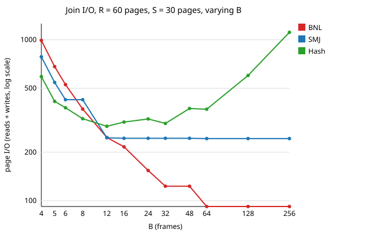
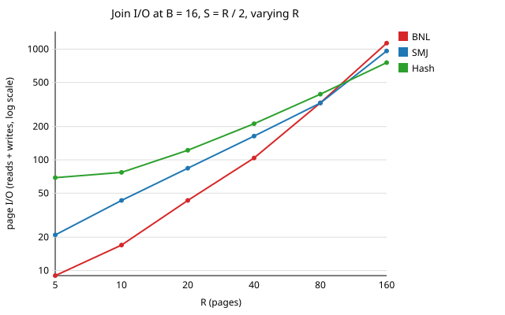

# REPORT_M2 — execution engine measurements

The five measurements of §M2.6, produced by `python bench/report_m2.py` (from the repo root, after building). The script only calls the `storage` and `exec` programs. It runs every plan twice and stops if the two runs' counters differ (§M2.1: same plan + same B → same counters), if any run holds more than B frames, or if a temporary file is left behind. None of those happened. The plots are in `bench/plots/`.

## Setup

**Machine and build:** Windows 11, MinGW GCC 15.2 (CLion's bundled toolchain), CMake + Ninja, default build type. The counters do not depend on the machine; only the run time does.

**Data:** the M2 dataset is NOT AVAILABLE, so the script builds its own tables. There are no random numbers; every value is a formula.
- **R and S:** `(a INT, b VARCHAR(10), c INT)` with 3-byte b values. A record is 4 + (2 + 3) + 4 = 13 bytes, so **240 rows fill a page** (4088 // (13 + 4)). Row i has a = i, so the join `R.a = S.a` matches exactly |S| rows. M and N are in pages.
- **Skew tables:** `(a INT, b INT)`, 340 rows per page.

**What a measured number means:**
- **Joins:** the page reads and writes on the join's trace line, that is the join plus its inputs (exec decision D1 (b)). This matches §M2.5's trace example and the textbook formulas, which include reading the inputs. For the nested loop join the formula counts reads only, so it is compared with reads; for sort-merge and hash join, with reads + writes.
- **Every seqscan reads its table's directory page once** as well as its M data pages (M1's heap file layout).

**How B is divided** (`DESIGN_M2.md` §3): an operator gives each child that runs at the same time exactly that child's minimum and keeps the rest. Consequences at the root:
- a join of two scans has a block of B − 2 (nested loop) or P = B − 1 partitions (hash);
- a sort above a scan makes pass-0 runs of **B − 1** pages, because the scan holds one frame.

**Sort variant: rewrite.** A leftover run in a merge pass is copied, so a sort costs `2·N·(passes − 1) + N` (M4's formula).

**Run pages are never cache hits:** every run page is written to disk once and dropped from the pool, so each later pass really reads it.

**Formulas used:**
- nested loop `M + ⌈M/(B−2)⌉·N`;
- sort-merge `sort(M) + sort(N) + M + N`, with sort(X) = `2·X·(passes − 1) + X` and passes = `1 + ceil(log(ceil(X/B)) / log(B−1))`;
- hash `3(M + N)`.

## 1. Cost against formula

Three relation sizes, B = 4, 16, 64, 256, join `R.a = S.a`. "Measured" is reads for the nested loop join (BNL) and reads + writes for sort-merge (SMJ) and hash.

| Join | B | M | N | Reads | Writes | Formula | Measured − formula | Notes |
|---|---|---|---|---|---|---|---|---|
| BNL | 4 | 20 | 10 | 131 | 0 | 120 | 11 |  |
| SMJ | 4 | 20 | 10 | 113 | 90 | 160 | 43 |  |
| Hash | 4 | 20 | 10 | 101 | 33 | 90 | 44 | partitions 21 + 12 pages; overflow 3 of 3 |
| BNL | 16 | 20 | 10 | 43 | 0 | 40 | 3 |  |
| SMJ | 16 | 20 | 10 | 54 | 30 | 100 | −16 |  |
| Hash | 16 | 20 | 10 | 77 | 45 | 90 | 32 | partitions 30 + 15 pages; overflow 0 of 15 |
| BNL | 64 | 20 | 10 | 32 | 0 | 30 | 2 |  |
| SMJ | 64 | 20 | 10 | 53 | 30 | 60 | 23 |  |
| Hash | 64 | 20 | 10 | 158 | 126 | 90 | 194 | partitions 63 + 63 pages; overflow 0 of 63 |
| BNL | 256 | 20 | 10 | 32 | 0 | 30 | 2 |  |
| SMJ | 256 | 20 | 10 | 53 | 30 | 60 | 23 |  |
| Hash | 256 | 20 | 10 | 542 | 510 | 90 | 962 | partitions 255 + 255 pages; overflow 0 of 255 |
| BNL | 4 | 60 | 30 | 991 | 0 | 960 | 31 |  |
| SMJ | 4 | 60 | 30 | 423 | 360 | 660 | 123 |  |
| Hash | 4 | 60 | 30 | 496 | 94 | 270 | 320 | partitions 62 + 32 pages; overflow 3 of 3 |
| BNL | 16 | 60 | 30 | 216 | 0 | 210 | 6 |  |
| SMJ | 16 | 60 | 30 | 154 | 90 | 360 | −116 |  |
| Hash | 16 | 60 | 30 | 200 | 108 | 270 | 38 | partitions 69 + 39 pages; overflow 0 of 15 |
| BNL | 64 | 60 | 30 | 92 | 0 | 90 | 2 |  |
| SMJ | 64 | 60 | 30 | 153 | 90 | 180 | 63 |  |
| Hash | 64 | 60 | 30 | 231 | 139 | 270 | 100 | partitions 76 + 63 pages; overflow 0 of 63 |
| BNL | 256 | 60 | 30 | 92 | 0 | 90 | 2 |  |
| SMJ | 256 | 60 | 30 | 153 | 90 | 180 | 63 |  |
| Hash | 256 | 60 | 30 | 602 | 510 | 270 | 842 | partitions 255 + 255 pages; overflow 0 of 255 |
| BNL | 4 | 180 | 90 | 8371 | 0 | 8280 | 91 |  |
| SMJ | 4 | 180 | 90 | 1533 | 1350 | 2520 | 363 |  |
| Hash | 4 | 180 | 90 | 3245 | 273 | 810 | 2708 | partitions 182 + 91 pages; overflow 3 of 3 |
| BNL | 16 | 180 | 90 | 1364 | 0 | 1350 | 14 |  |
| SMJ | 16 | 180 | 90 | 633 | 450 | 1080 | 3 |  |
| Hash | 16 | 180 | 90 | 555 | 283 | 810 | 28 | partitions 186 + 97 pages; overflow 0 of 15 |
| BNL | 64 | 180 | 90 | 454 | 0 | 450 | 4 |  |
| SMJ | 64 | 180 | 90 | 454 | 270 | 1080 | −356 |  |
| Hash | 64 | 180 | 90 | 592 | 320 | 810 | 102 | partitions 194 + 126 pages; overflow 0 of 63 |
| BNL | 256 | 180 | 90 | 272 | 0 | 270 | 2 |  |
| SMJ | 256 | 180 | 90 | 453 | 270 | 540 | 183 |  |
| Hash | 256 | 180 | 90 | 782 | 510 | 810 | 482 | partitions 255 + 255 pages; overflow 0 of 255 |

### Why measurement and formula differ

**Block nested loop: the gap is exactly the directory pages.** The outer is scanned once and the inner once per block, and each scan reads its directory page once. So measured = formula + 1 + ⌈M/(B−2)⌉ in every row. For example, M = 20, B = 4: 120 + 1 + 10 = 131; M = 180, B = 4: 8280 + 1 + 90 = 8371. When the outer fits in one block (B − 2 ≥ M) the gap is 2. Writes are always 0: the join writes nothing (§M2.3: one block, one inner page, one output). This is the join whose formula we match best.

**Sort-merge join: the formula counts some reads twice and assumes each sort has all of B.** The gap goes both ways, for four reasons.
1. **No separate merge read (puts us below).** Both sorts stream their final merge straight into the join ("using your sort operator", §M2.3), so reading the sorted inputs *is* the sorts' final pass. The formula's sort(X) already includes that final read, and its `+ M + N` adds it again. A design that wrote each sorted input to disk and read it back would match the formula's `+ M + N`; ours saves it, so it can come out below the formula: M = 60, B = 16: 244 against 360; M = 180, B = 64: 724 against 1080.
2. **The two final merges share B (puts us above at small B).** Both sorts stream at the same time, so their final merges split the stream frames, with one page kept for the run of equal keys. At B = 4 the left sort may merge only 2 runs at the end and the right sort only 1, so each needs an extra merge pass. That writes and re-reads the whole input once more. The formula assumes each sort has all B frames. M = 60, B = 4: 783 against 660.
3. **Pass-0 runs are B − 1 pages** (the scan holds one frame), so a sort can make more runs than ⌈X/B⌉ (measurement 2).
4. **An input that would fit in memory is still written once (puts us above at large B).** Each sort must hold no frame while the other input is sorted, so even a small input goes to disk once. At B = 64 and 256 the formula's sorts are one pass with no writes (sort(X) = X), while we write each input once and read it once. M = 20, B = 256: 83 against 60, where the writes are exactly 20 + 10 = 30.
5. **The merge stops when one input ends** (§M2.3 "while r and s"). Here S's keys end at |S| − 1, so the left sort's final merge reads only about half of R. This lowers reads in every row.

**Hash join: partitions are not full pages, and at B = 4 every partition overflows.**
- **Partly full pages.** P = B − 1 (§M2.3), and each partition's last page is usually only partly full. So partitioning writes more than M + N pages, and probing reads the same number again.
  - At B = 16 the effect is small: M = 180 writes 186 + 97 = 283 pages instead of 270, so 838 against 810.
  - When P is large next to the input, every partition holds only a few rows on its own page. M = 20, N = 10 at B = 256 writes 255 + 255 = 510 pages for 30 pages of data, and the I/O is 1052 against the formula's 90. The formula assumes full partitions, which is only true when the input is much larger than P.
- **Overflow at B = 4.** P = 3 and the table gets 3 pages, but each left partition is about M/3 pages. So every pair is joined by block nested loop (`DESIGN_M2.md` §9): R_i + ⌈R_i/2⌉ · S_i reads per pair. For M = 180 that is about 61 + 31 · 31 ≈ 1022 per pair, 3245 reads in all, against the formula's 810.
- **Two directory pages** in every row.

## 2. Sort passes

`sort(seqscan)` of N pages at B frames. "Measured passes" is pass 0 plus every merge pass, the streaming final one included (the sort's `details` in `exec trace --json`).

| N | B | N = 20B | Measured passes | Formula passes | Runs after pass 0 | ⌈N/B⌉ | ⌈N/(B−1)⌉ | Sort's own reads | Sort's own writes |
|---|---|---|---|---|---|---|---|---|---|
| 8 | 4 |  | 2 | 2 | 3 | 2 | 3 | 8 | 8 |
| 12 | 4 |  | **3** | **2** | 4 | 3 | 4 | 24 | 24 |
| 80 | 4 | yes | 4 | 4 | 27 | 20 | 27 | 240 | 240 |
| 30 | 8 |  | 2 | 2 | 5 | 4 | 5 | 30 | 30 |
| 60 | 16 |  | 2 | 2 | 4 | 4 | 4 | 60 | 60 |
| 200 | 16 |  | 2 | 2 | 14 | 13 | 14 | 200 | 200 |
| 200 | 64 |  | 2 | 2 | 4 | 4 | 4 | 200 | 200 |
| 800 | 32 |  | 2 | 2 | 26 | 25 | 26 | 800 | 800 |

**7 of the 8 pairs match the formula,** including N = 20 × B (80 pages at B = 4: 4 passes).

**The one difference is N = 12, B = 4** (3 measured against 2). Inside a plan the input scan holds one frame, so pass 0 has B − 1 = 3 frames and makes ⌈N/(B−1)⌉ runs, not ⌈N/B⌉. The "runs after pass 0" column always equals ⌈N/(B−1)⌉.
- Usually the extra runs do not change the pass count.
- At N = 12 they do: 4 runs need a merge pass at fan-in 3, while the formula's 3 runs would fit the final merge.

**The sort's own I/O matches our stated variant exactly in every row:** reads = writes = N·(passes − 1), plus N reads of the input charged to the scan. That is the rewrite variant (§M2.3: "measured totals must match your own description"). The spec's own example (N = 8, B = 3: 3 passes, 24 reads + 16 writes) needs a sort with exactly 3 frames in pass 0, which no plan can give it, because the input holds a frame. It is reproduced by the unit test `external_sort_tests.cpp`, which runs the sorter directly.

## 3. Crossover

Total measured page I/O (reads + writes) of each join.

### 3a. Fixed relations (R = 60 pages, S = 30 pages), varying B

| B | BNL | SMJ | Hash | Cheapest |
|---|---|---|---|---|
| 4 | 991 | 783 | 590 | Hash |
| 5 | 681 | 543 | 414 | Hash |
| 6 | 526 | 424 | 378 | Hash |
| 8 | 371 | 424 | 323 | Hash |
| 12 | 247 | 246 | 290 | SMJ |
| 16 | 216 | 244 | 308 | BNL |
| 24 | 154 | 244 | 322 | BNL |
| 32 | 123 | 244 | 302 | BNL |
| 48 | 123 | 244 | 374 | BNL |
| 64 | 92 | 243 | 370 | BNL |
| 128 | 92 | 243 | 600 | BNL |
| 256 | 92 | 243 | 1112 | BNL |

**The ranking changes twice: between B = 8 and B = 12 (hash stops being cheapest), and at B = 16 (BNL becomes cheapest and stays so).**
- **Small B (4 to 8): hash wins.** The nested loop's ⌈M/(B−2)⌉ factor is large: 30 blocks at B = 4, so S is read 30 times. Sort-merge needs extra merge passes. Hash partitioning costs about 3(M + N) almost regardless of B, plus some overflow at B = 4–6.
- **B = 12: sort-merge and the nested loop are tied (246 and 247), and hash has fallen behind.** The nested loop's blocks are now 10 pages (6 blocks). Hash's cost has started to *rise* with B: every one of the P = B − 1 partitions ends with a partly full page, so more partitions mean more pages written and read.
- **B ≥ 16: the nested loop is cheapest.** Its cost `M + ⌈M/(B−2)⌉·N` keeps falling as the block grows. It reaches M + N once the whole outer fits in one block (B − 2 ≥ 60, so B = 64), which is the least any join can cost here: each page read once, nothing written. Sort-merge flattens at about 244 (both sorts fit in one pass plus one written run). Hash keeps growing: 1112 at B = 256, where 255 partitions per side are each a mostly empty page.

**Cause, in short:** BNL's ⌈M/(B−2)⌉ factor collapses as B grows, while hash's cost grows with B because P = B − 1 creates more partly full partition pages. The textbook expectation is that hash stays cheaper than the nested loop until the outer nearly fits in memory. That would hold if partitions were always full pages, which is only true when the input is much larger than P.

### 3b. Fixed B = 16, varying size (N = M / 2)

| M (N = M/2) | BNL | SMJ | Hash | Cheapest |
|---|---|---|---|---|
| 5 | 9 | 21 | 69 | BNL |
| 10 | 17 | 43 | 77 | BNL |
| 20 | 43 | 84 | 122 | BNL |
| 40 | 104 | 164 | 212 | BNL |
| 80 | 327 | 326 | 392 | SMJ |
| 160 | 1133 | 963 | 756 | Hash |

**The ranking changes between M = 40 and M = 80 (sort-merge overtakes the nested loop) and between 80 and 160 (hash becomes cheapest).**
- **Small relations: the nested loop wins.** With B − 2 = 14 the outer fits in one or two blocks, so S is read once or twice. The nested loop also writes nothing. Hash always pays P = 15 partly full partitions per side, a fixed cost of roughly 30 pages even for tiny inputs. Sort-merge writes each input once.
- **As M grows, the nested loop's cost grows like M²/(B − 2):** ⌈M/14⌉ blocks, each reading all M/2 pages of S. Sort-merge grows like M·log M, and hash about linearly, 3(M + N) plus its fixed partition overhead. So the nested loop is overtaken first by sort-merge (they are equal at M = 80: 327 and 326), then by hash. Hash wins at M = 160, where its fixed overhead is small next to 3(M + N).

## 4. Skew

The hash join on R = 6800 rows (20 pages) and S = 3400 rows (10 pages) of `(a INT, b INT)`.
- **Skewed data:** **40 % of the rows on both sides have b = 7** (2720 rows of R, 1360 of S). The other keys are distinct, and some of S's match R's.
- **Uniform data:** the same sizes with all-distinct keys.

Condition `R.b = S.b`. "Partition pages" lists each partition's pages, from `exec trace --json`.

| B | Data | P | Left partition pages | Right partition pages | Overflowed (block nested loop) | Reads | Writes | I/O | Comparisons | Rows |
|---|---|---|---|---|---|---|---|---|---|---|
| 4 | uniform | 3 | 7 7 7 | 4 4 4 | 0, 1, 2 | 101 | 33 | 134 | 7,708,115 | 3,400 |
| 4 | 40 % skew | 3 | 13 4 5 | 7 2 3 | 0, 1, 2 | 115 | 34 | 149 | 10,201,324 | 3,701,240 |
| 8 | uniform | 7 | 3 4 3 3 3 3 3 | 2 2 2 2 2 2 2 | none | 68 | 36 | 104 | 4,339 | 3,400 |
| **8** | **40 % skew** | 7 | 2 2 2 2 2 **10** 2 | 1 1 1 1 1 **5** 1 | **5** | 70 | 33 | 103 | 5,386,119 | 3,701,240 |
| 16 | uniform | 15 | 2 (× 15) | 1 (× 15) | none | 77 | 45 | 122 | 3,605 | 3,400 |
| 16 | 40 % skew | 15 | **9**, then 1 (× 14) | **5**, then 1 (× 14) | none | 74 | 42 | 116 | 3,702,678 | 3,701,240 |
| 64 | uniform | 63 | 1 (× 63) | 1 (× 63) | none | 158 | 126 | 284 | 3,412 | 3,400 |
| 64 | 40 % skew | 63 | 1 (× 62) and **9** | 1 (× 62) and **5** | none | 170 | 138 | 308 | 3,701,244 | 3,701,240 |

**What happened to the partitions:** all 2720 rows with b = 7 land in **one** partition at every B (partition 0 at B = 4 and 16, 5 at B = 8, 54 at B = 64). That partition alone holds 9–10 pages of the left input's 20, plus its share of the other keys. Changing B, and so P, does not split it: the same key gives the same hash, so every copy follows it.

**What the overflow handling did** (block nested loop on the pair, `DESIGN_M2.md` §9):
- **B = 8 shows the effect most clearly.** With uniform data every partition (3–4 pages) fits the 7-page table and nothing overflows. With skew, partition 5 has 10 pages, more than the table. The join detects this from the page count before building, and joins that one pair by block nested loop instead: blocks of 6 pages, so 2 blocks, and S_5 (5 pages) is read twice.
- **B = 16 and 64:** the skewed partition (9 pages) still fits the table (15 or 63 pages), so there is no overflow, just one large partition.
- **B = 4:** every partition overflows, skewed or not, because a 3-page table is smaller than a third of the input.

**Cost against the uniform case:**
- **Page I/O hardly changes** (B = 8: 103 against 104). The fallback adds only S_5's second read (5 pages). The skewed data's other partitions are smaller, which saves about as much.
- **Comparisons explode: 5.4 million against 4,339.** Most of that is not wasted work: the skewed key alone produces 2720 × 1360 = 3,699,200 output rows, and every one of them needs a key comparison in any join algorithm. The block nested loop adds the comparisons of every pair in that partition, matching or not.
- **At B = 4,** where everything overflows anyway, skew costs 149 against 134 I/O. The large partition (13 pages) needs 7 blocks against S_0's 7 pages.

**Why rehashing would not help:** re-partitioning the overflowing pair with a new hash function (§M2.3 option (a)) would send all 2720 copies of b = 7 to one sub-partition again, at any depth. One key can never be split by hashing, so (a) would always end in (b) anyway. That is why we chose (b) directly.

## 5. The budget

| Plan | B | Largest number of frames held at once | Reads | Writes | Rows |
|---|---|---|---|---|---|
| sort of 80 pages (= 20 × B) | 4 | **4** | 321 | 240 | 19,200 |
| hash join over that sort (with R = 20 pages) | 4 | **4** | 933 | 422 | 4,800 |

**A sort of 20 × B = 80 pages at B = 4 completes.** It makes 27 runs, needs 4 passes, and returns all 19,200 rows in order.

**The largest number of frames held at once was 4 = B, and never more.**

**How we know.** Every page an operator keeps in memory is a buffer-pool frame:
- pages read from a file are pinned frames;
- tuples kept in memory (a sort's run, a hash table, a block) live in frames reserved from the pool (`DESIGN_M2.md` §2).

The pool updates a peak counter on every pin and every reservation. `ExecutablePlan::open()` resets it and `exec trace --json` reports it as `max_frames_held`. So the peak cannot miss a moment, and no tuple is held outside it. The pool also *refuses* to give out a frame beyond B, raising an error, so a plan that tried to hold more would fail instead of silently going over. The unit test "checklist: a sort of 20 x B pages at B = 4 completes within 4 frames" asserts the same, and `bench/exec_acceptance.py` checks `max_frames_held ≤ B` on every one of its ~250 runs.
